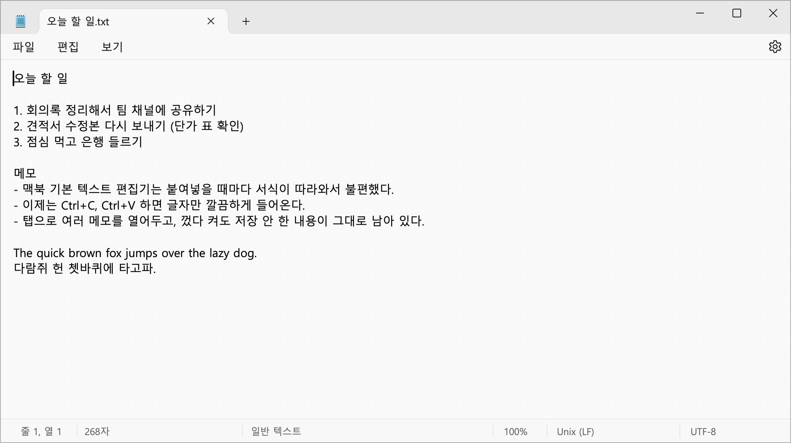

# WinNote for Mac



맥북 텍스트 편집기, 불편하지 않으셨나요?

만년 윈도우 유저로 살다가 이번에 맥으로 넘어왔는데, 기본 텍스트 편집기에는 도저히 적응이 안 되더라고요.
붙여넣을 때마다 서식이 따라오고, 메모 하나 쓰려고 해도 손에 익지 않았습니다.

그래서 만들었습니다. **Windows 11 메모장을 그대로 맥으로 옮긴 `notepad`입니다.** 특유의 모난 디자인까지 전부요.

## 특징

- **서식 없는 복사, 붙여넣기**
  어디서 복사해 오든 글자만 들어갑니다. 복사할 때도 순수 텍스트만 클립보드에 올라갑니다.
- **Windows 11 메모장 그대로**
  탭 표시줄, 메뉴, 상태 표시줄, 각진 창 모서리, 최소화/최대화/닫기 버튼까지 원본과 같은 크기와 위치로 맞췄습니다.
- **맑은 고딕**
  윈도우에서 보던 그 글꼴, 그 줄 간격 그대로입니다.
- **손에 익은 단축키**
  Ctrl+C, Ctrl+V, Ctrl+S, Ctrl+F, Ctrl+H, Ctrl+G, F3, F5 등 Windows 단축키가 그대로 동작합니다. Cmd 조합도 똑같이 됩니다. Home과 End는 줄의 처음과 끝으로 이동합니다.
- **탭과 세션 복원**
  여러 메모를 탭으로 열어두고, 껐다 켜도 저장하지 않은 내용이 그대로 남아 있습니다.
- **그 밖의 기능**
  찾기 및 바꾸기, 줄로 이동, 시간/날짜 삽입, Bing으로 검색, 확대/축소, 자동 줄 바꿈, 인쇄, 밝게/어둡게 테마를 지원합니다.
- **인코딩 자동 감지**
  UTF-8, UTF-8(BOM), UTF-16 LE/BE, ANSI(CP949)를 자동으로 감지하고, 열었던 인코딩 그대로 저장합니다.

원본과 다른 점도 있습니다. 마크다운 서식 기능과 Copilot은 뺐고, 새 문서의 줄바꿈은 macOS에 맞춰 LF로 저장합니다.

## 설치

### Homebrew

```bash
brew install --cask cheonwoong-park/tap/winnote
```

설치하면 응용 프로그램 폴더에 `notepad`가 생깁니다. 업데이트는 `brew upgrade --cask winnote`로 하면 됩니다.

### 직접 빌드

macOS 13 이상, Xcode Command Line Tools가 필요합니다.

```bash
git clone https://github.com/CheonWoong-Park/WinNote_for_Mac.git
cd WinNote_for_Mac
./build.sh
open build/notepad.app
```

`build/notepad.app`을 응용 프로그램 폴더로 옮기면 끝입니다.

## 라이선스

소스 코드는 [MIT 라이선스](LICENSE)를 따릅니다.

맑은 고딕(Malgun Gothic), 메모장 아이콘 폰트, 앱 아이콘은 Microsoft Corporation의 자산이며 MIT 라이선스의 대상이 아닙니다.
이 프로젝트는 Microsoft와 관련이 없는 개인 프로젝트입니다.
